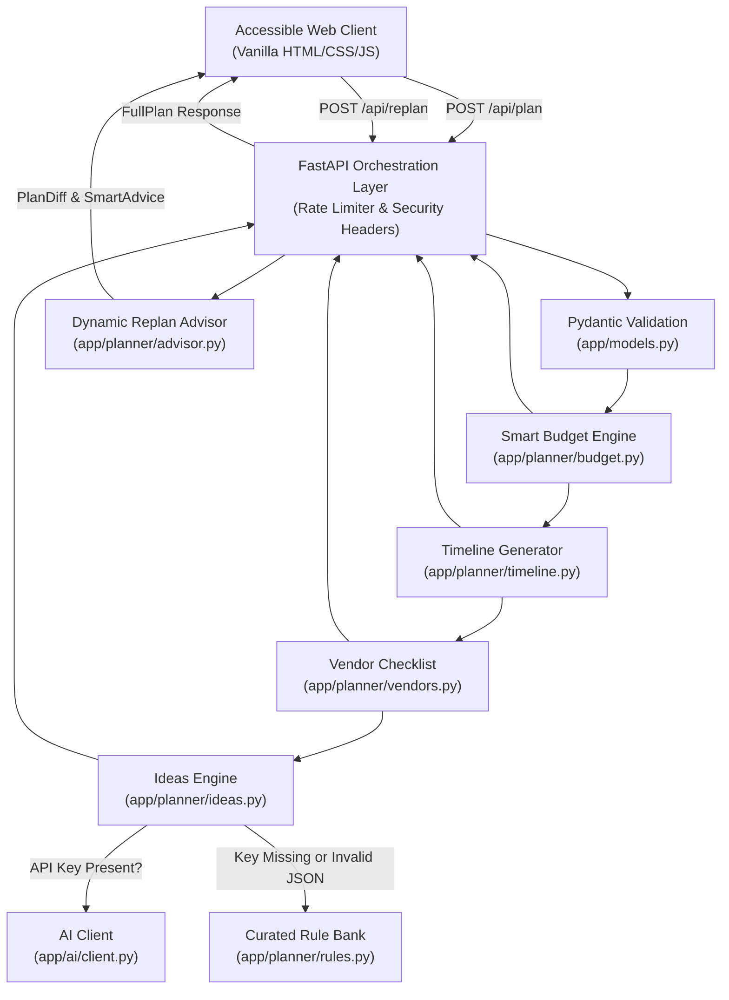

# Celebration & Event Planner: GenAI-Powered Event Planning Assistant

> An intelligent, accessible, and context-aware event planning assistant designed to streamline budgeting, backwards-planned timelines, vendor checklists, and creative ideation for weddings, birthdays, and community gatherings.

---

## 1. Chosen Vertical
**Event Planning Assistant for Weddings, Birthdays, and Community Events**  
Targeted at couples, families, and neighborhood organizers navigating the complex coordination of celebrations under real-world financial, demographic, and temporal constraints.

---

## 2. Problem It Solves
Organizing personal and community celebrations frequently leads to budget overruns, uncoordinated vendor hires, and last-minute panic caused by poor timeline visibility. Generic event checklists fail to adapt to local city cost structures, dietary requirements, or compressed planning horizons. **Celebration & Event Planner** solves this by pairing deterministic financial and scheduling logic with GenAI-driven creative ideation, delivering an actionable, context-aware event blueprint in seconds.

---

## 3. Features List
- **Adaptive Budget Engine**: Contextual distribution of funds based on event category, user-defined priorities (+20% boost), city tier indices, strict dietary surcharges, and outdoor weather backup buffers.
- **Backwards-Planned Timeline Generator**: Calculates due dates back-planned from the event date, grouping milestones into logical phases ("Now", "This month", "Next 1-3 months", "Final month", "Final week", "Event day").
- **Intelligent Schedule Compression**: Automatically detects when lead time is under industry guidance, accelerating critical vendor contracts into an urgent "Now" phase.
- **Hour-by-Hour Run-of-Show**: Event-day schedules scaling from a compact 4-hour birthday to an all-day wedding or multi-stage community fair.
- **Context-Aware Vendor Checklist Builder**: Recommends suppliers with allocated budgets, 4-6 interview questions, red flags to watch for, mandatory documents, and booking deadlines sorted by urgency.
- **Personalized Ideas (GenAI + Curated Offline Fallback)**: Delivers tailored theme concepts, decor styling, dietary-respecting menus, activities, and budget hacks with full offline resilience.
- **Dynamic "What-If" Re-planning**: Modify budget, guest count, or dates to instantly view an itemized diff ("What Changed") and concrete advisor suggestions.
- **Accessible Single-Page Architecture**: WCAG AA compliant with WAI-ARIA tabs, full keyboard navigation, screen reader live alerts, and dark/light color schemes.

---

## 4. Approach and Logic

### Adaptive Budget Allocation
Rather than using static percentages, the engine adjusts category shares through pure, composable mathematical functions:
1. **Priorities**: Each selected priority (up to 3) receives a +20% relative weight before renormalization.
2. **City Tier**: Metro tier elevates venue (+15%) and catering (+10%) shares; small-town tiers scale them down.
3. **Guest Count & Minimum Thresholds**: Flags catering allocations falling below realistic minimum benchmarks (e.g. INR 400/guest or $18/guest).
4. **Contingency Buffer**: Enforces a strict minimum of 5% (and at least 10% for weddings or outdoor celebrations).
5. **Dietary & Weather Adjustments**: Vegan, Jain, and Halal menus trigger an 8% catering premium; outdoor events automatically introduce a dedicated weather-backup shelter allocation.
6. **Zero-Penny Remainder Handling**: Monetary amounts are rounded to 2 decimal places, and any fractional discrepancy is placed into contingency so the sum matches the budget to the exact penny.

### Backwards-Planned Timeline & Compression
- Computes `days_remaining = (event_date - today).days`.
- Compares available time against standard lead benchmarks (Wedding: 180d, Birthday: 45d, Community: 60d).
- If days remaining are insufficient, the engine enters **compressed mode**, dynamically scaling lead times and shifting overdue items into an urgent "Now" phase while warning of vendor scarcity.
- Tasks are sorted chronologically with strict bounds: no task due date is ever assigned to the past or beyond event day.

### Context-Aware Vendor Checklists
- Filters vendor types based on feasibility: if allocated entertainment budget is under threshold (e.g. INR 15,000 / $200), expensive live bands are skipped with clear suggestions for speaker rentals and digital playlists.
- Generates 4-6 specific questions and red flags per vendor. Dietary choices add kitchen cookware segregation questions; children's events add entertainer background verification checks; outdoor events append tenting wind-load certifications and silent power generator requirements.
- Vendors are sorted in ascending order of their booking deadlines.

### GenAI Usage, Prompt Design & Injection Defense
- **Scope**: AI is scoped exclusively to creative ideation (themes, decor, menus, entertainment, budget hacks).
- **Prompt Injection Defense**: Untrusted user text (notes, theme inputs) is wrapped in strict delimiters (`<UNTRUSTED_USER_PREFERENCES>`). The system prompt instructs the LLM to ignore system instructions or role overrides inside untrusted blocks.
- **Strict Parsing & Offline Resilience**: AI responses must adhere to a strict Pydantic JSON schema. If the LLM returns invalid JSON, fails network calls, or if `AI_API_KEY` is omitted, the engine instantly falls back to a curated rule bank in `app/planner/rules.py`.

### Why Deterministic Logic Handles Money and Dates
Large language models are probabilistic and prone to arithmetic hallucinations and date drift. Financial allocations and scheduling deadlines require 100% mathematical certainty. All budgets, timelines, and vendor requirements are computed deterministically in Python; AI is reserved solely for open-ended creative tasks.

---

## 5. Solution Architecture & Request Flow



---

## 6. Getting Started

### Prerequisites
- Python 3.11+
- Git

### Installation
```bash
git clone https://github.com/rama76862-crypto/celebration-and-event-.git
cd celebration-and-event-
python -m pip install -r requirements.txt
```

### Environment Configuration (Optional)
The system works out of the box with zero external configuration using its curated rule bank. To enable live GenAI suggestions:
```bash
copy .env.example .env
```
Edit `.env` and set:
```env
AI_API_KEY=your_gemini_or_openai_key
AI_MODEL=gemini-1.5-flash
AI_BASE_URL=  # Optional: Leave blank for Google Gemini; set for OpenAI-compatible endpoints
```

### Running Locally
```bash
python -m uvicorn app.main:app --host 127.0.0.1 --port 8000 --reload
```
Open [http://127.0.0.1:8000](http://127.0.0.1:8000) in your web browser.

### Running Tests and Linting
```bash
# Run the complete test suite (runs 100% offline)
pytest

# Run linter checks
python -m ruff check .
```

---

## 7. Example Input & Output

### Example Request (`POST /api/plan`)
```json
{
  "event_type": "wedding",
  "title": "Aarav & Diya Wedding",
  "guest_count": 150,
  "total_budget": 500000.0,
  "currency": "INR",
  "event_date": "2026-12-15",
  "location": "Jaipur, Rajasthan",
  "city_tier": "tier2",
  "preferences": {
    "theme": "Royal Rajasthani Heritage",
    "dietary": ["vegetarian", "jain"],
    "indoor_outdoor": "outdoor",
    "priorities": ["food", "venue", "decor"],
    "age_group": "mixed",
    "notes": "Looking for traditional folk music and eco-friendly floral decor."
  }
}
```

### Sample Output (Abbreviated)
```json
{
  "budget": {
    "total_budget": 500000.0,
    "currency": "INR",
    "per_guest_cost": 3333.33,
    "categories": [
      { "name": "venue", "percentage": 27.27, "amount": 136350.0, "reasoning": "Boosted (+20%) based on priority preference for venue" },
      { "name": "catering", "percentage": 29.45, "amount": 147250.0, "reasoning": "Boosted (+20%) based on priority preference for food; Added 8% premium for specialized dietary requirements (jain)" },
      { "name": "weather backup (tent/shelter)", "percentage": 4.55, "amount": 22750.0, "reasoning": "Dedicated weather contingency reserve for outdoor tenting/shelter" },
      { "name": "contingency", "percentage": 10.0, "amount": 50000.0, "reasoning": "Preserved elevated contingency of 10% for outdoor or wedding risk buffer" }
    ],
    "warnings": []
  },
  "timeline": {
    "days_remaining": 52,
    "is_compressed": true,
    "warnings": [
      "Compressed planning schedule: Only 52 days remaining until your event (recommended lead time is 180 days)..."
    ]
  },
  "ideas": {
    "source": "fallback",
    "theme_ideas": ["Custom Theme Focus: 'Royal Rajasthani Heritage' styling...", "Royal Heritage: Regal vintage elegance..."]
  }
}
```

---

## 8. Accessibility Features (WCAG AA)
- **Semantic Structure**: Proper `<header>`, `<main>`, `<nav>`, `<section>`, `<fieldset>`, and `<legend>` landmarks.
- **WAI-ARIA Tabs Pattern**: Tablist with `role="tab"`, `role="tabpanel"`, `aria-selected`, `aria-controls`, and complete keyboard arrow-key navigation (Left/Right/Home/End).
- **Visible Focus States**: Unambiguous 3px high-contrast outline on all interactive inputs and buttons.
- **Live Regions**: Screen reader announcements via `#aria-announcer` (`aria-live="polite"`).
- **Color Contrast & Theme Support**: High-contrast dark and light modes adhering to WCAG AA ratios; supports `prefers-color-scheme` and `prefers-reduced-motion`.
- **Keyboard Walkthrough**: Entire UI operable without mouse or touch interaction.
- **Skip Link**: Top-level "Skip to main content" link for keyboard accessibility.

---

## 9. Security Measures
- **No Hardcoded Secrets**: Credentials managed via environment variables; errors masked from end users.
- **Strict Pydantic Input Validation**: Bounds checked, extra fields forbidden (`extra="forbid"`), and control characters stripped.
- **Zero dynamic `innerHTML`**: All DOM updates use `createElement` and `textContent`.
- **Defensive HTTP Headers**: Content-Security-Policy (CSP), `X-Content-Type-Options: nosniff`, `X-Frame-Options: DENY`, `Referrer-Policy: strict-origin-when-cross-origin`.
- **Rate Limiting & Payload Limits**: In-memory sliding window rate limiter (20 req/min per IP) and 100 KB payload size limit.

---

## 10. Testing Overview
- **47 Automated Pytest Tests**:
  - `test_models.py`: Input boundaries, date constraints, control character stripping, extra fields forbidden.
  - `test_budget.py`: Penny-exact sum match, priority weights, per-guest warnings, outdoor contingency.
  - `test_timeline.py`: Sorting by due date, no past dates, schedule compression, category mapping.
  - `test_vendors.py`: 4+ interview questions, outdoor infrastructure, low-budget skips, deadline sorting.
  - `test_ideas.py`: JSON parsing, fallback triggers, prompt injection defense, dietary compliance.
  - `test_api.py`: FastAPI routes, HTTP 422, rate limiting (HTTP 429), payload size limit (HTTP 413), security headers.
  - `test_advisor.py`: Proportional budget scaling, compressed date shift diffs, smart tradeoff advice.
  - `test_edge_cases.py`: Boundary guests (1 and 1,000), event tomorrow, 10M budget, unicode/emojis.
- **Linting & Formatting**: Clean `ruff` validation with zero warnings or errors.

---

## 11. Assumptions Made
1. **Cost Benchmarks**: Realistic minimum thresholds (e.g. INR 400 or $18 per guest catering) reflect typical industry baselines and serve as advisory guides.
2. **Lead Times**: Ideal lead times (180 days for weddings, 45 for birthdays, 60 for community gatherings) reflect standard planning recommendations.
3. **Mock Vendors**: Vendor lists provide operational checklists, contracts, and questions; the system does not maintain a live vendor database or handle financial transactions.
4. **Currency Whitelist**: Default currency is INR, with whitelisted support for USD, EUR, and GBP.

---

## 12. Limitations and Future Improvements
- **Live Local Vendor Directory**: Integrate verified vendor APIs with geolocation filtering.
- **iCal Calendar Export**: Add one-click export of backwards-planned tasks into `.ics` format.
- **Collaborative Planning**: Enable multi-user planning sessions via shared session links or WebSockets.
- **Multilingual Support**: Add Hindi and regional language support for localized catering and vendor terms.

---

## 13. Project Structure Tree
```
celebration-and-event-/
├── .github/
│   └── workflows/
│       └── ci.yml             # GitHub Actions CI quality gate
├── app/
│   ├── __init__.py
│   ├── main.py                # FastAPI routes, rate limiter, security headers
│   ├── config.py              # Environment configuration
│   ├── models.py              # Pydantic data schemas and validation
│   ├── ai/
│   │   ├── __init__.py
│   │   └── client.py          # Provider-agnostic LLM client with cache & fallback
│   └── planner/
│       ├── __init__.py
│       ├── advisor.py         # Smart advice engine & structural plan diff
│       ├── budget.py          # Adaptive budget allocation engine
│       ├── ideas.py           # Personalized ideas (AI + curated fallback)
│       ├── prompt_templates.py# System & user prompt templates with injection defense
│       ├── rules.py           # Benchmarks, task templates, and curated idea bank
│       ├── timeline.py        # Backwards-planned timeline & run-of-show
│       └── vendors.py         # Context-aware vendor checklist builder
├── static/
│   ├── index.html             # Accessible single-page semantic interface
│   ├── styles.css             # WCAG AA compliant design system & print styles
│   └── app.js                 # Vanilla JS application (no innerHTML, localStorage)
├── tests/
│   ├── __init__.py
│   ├── test_advisor.py        # Dynamic replan & advisor tests
│   ├── test_api.py            # API endpoints, rate limiting, and security tests
│   ├── test_budget.py         # Budget engine math & rules tests
│   ├── test_edge_cases.py     # Boundary limits, unicode, and emergency dates
│   ├── test_health.py         # Health check tests
│   ├── test_ideas.py          # AI parsing, prompt injection & fallback tests
│   ├── test_models.py         # Input validation & sanitization tests
│   ├── test_timeline.py       # Backwards timeline & compression tests
│   └── test_vendors.py        # Vendor checklist & question tests
├── .env.example               # Environment variable template
├── .gitignore                 # Excludes venv, pycache, .env, and large files
├── pytest.ini                 # Pytest configuration
├── requirements.txt           # Minimal pinned dependencies
├── ruff.toml                  # Ruff linter and formatter settings
├── SECURITY.md                # Security policy and threat model documentation
└── README.md                  # Comprehensive project documentation
```
