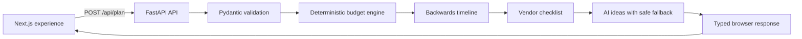

# Celebration & Event Studio

An accessible, context-aware planning assistant for weddings, birthdays, and community gatherings. It turns an event brief into a budget, backwards-planned timeline, vendor interview checklist, creative moodboard, and a what-if replanning comparison.

## Chosen vertical

**Celebration and event planning.** The product is designed for couples, families, and community organizers who need realistic decisions across budget, time, guest count, dietary needs, and venue conditions.

## How it works



- **Money and dates are deterministic.** The backend calculates allocations, due dates, schedule compression, and replanning diffs instead of asking an LLM to do arithmetic.
- **Creative ideation is optional AI.** A provider-agnostic AI client is used only for themes, decor, menus, activities, and savings ideas. Invalid or unavailable AI responses transparently fall back to curated, dietary-aware ideas.
- **The API mirrors the frontend contract.** Response adapters return exactly the budget, timeline, vendor, moodboard, and replanning fields rendered by the Next.js client.
- **The frontend wakes the API.** The shared footer calls `/health` when the deployed site opens, reporting service status while waking a sleeping backend without sending event data.

## Quality and safety

- Pydantic validation rejects unknown fields, invalid budgets, oversized inputs, and past event dates.
- Text inputs are length-bounded and control characters are removed.
- AI prompts fence user text as untrusted data; invalid structured output is rejected.
- Rate limiting, payload limits, CORS restrictions, and security headers protect public endpoints.
- No deployment token or AI key is committed. Copy `.env.example` only for local configuration.
- The UI has semantic landmarks, keyboard-operable controls, clear focus treatments, and client-side graceful fallbacks.

## Run locally

Prerequisites: Python 3.11+, Node.js 20+, and npm.

```powershell
python -m pip install -r requirements.txt
Copy-Item .env.example .env
python -m uvicorn app.main:app --host 127.0.0.1 --port 8000 --reload
```

In a second terminal:

```powershell
Set-Location frontend
npm ci
npm run dev
```

Open `http://localhost:3000`. The frontend defaults to `http://127.0.0.1:8000`; set `NEXT_PUBLIC_API_URL` to point it at another API.

## Validation

```powershell
python -m pytest -q
python -m ruff check app tests
Set-Location frontend
npm run lint
npm run build
```

The automated suite covers model validation, exact budget allocation, compressed timelines, vendor logic, AI fallbacks, HTTP headers, rate limits, and replanning behavior.

## Deployment

The repository includes [`render.yaml`](render.yaml) for the FastAPI service. Create a Render Blueprint from this repository, use `main` as its only deployment branch, and set `FRONTEND_ORIGINS` to the final Vercel URL. `AI_API_KEY` is optional: the app remains fully functional with curated ideas when it is absent.

Deploy `frontend/` to Vercel with these environment variables:

```text
STATIC_EXPORT=true
NEXT_PUBLIC_API_URL=https://your-render-service.onrender.com
```

Set `NEXT_PUBLIC_API_URL` before the production build so API requests and the automatic wake-up health check target the deployed backend.

## Assumptions

- Cost benchmarks are planning guidance, not vendor quotes.
- Vendor records are actionable sourcing checklists, not a marketplace or payment service.
- AI suggestions are creative starting points; the planner’s financial and scheduling decisions remain deterministic.
- The app intentionally has no authentication because it stores no user account or event data. If persistence is added, authentication and per-user data controls should be introduced first.

## Project structure

```text
app/                 FastAPI API, models, presentation adapters, planning engines
app/ai/              Provider-agnostic AI client
app/planner/         Budget, timeline, vendors, ideas, rules, and replan logic
frontend/            Next.js user experience and API client
tests/               Offline backend unit and integration tests
render.yaml          Render web-service blueprint
```
