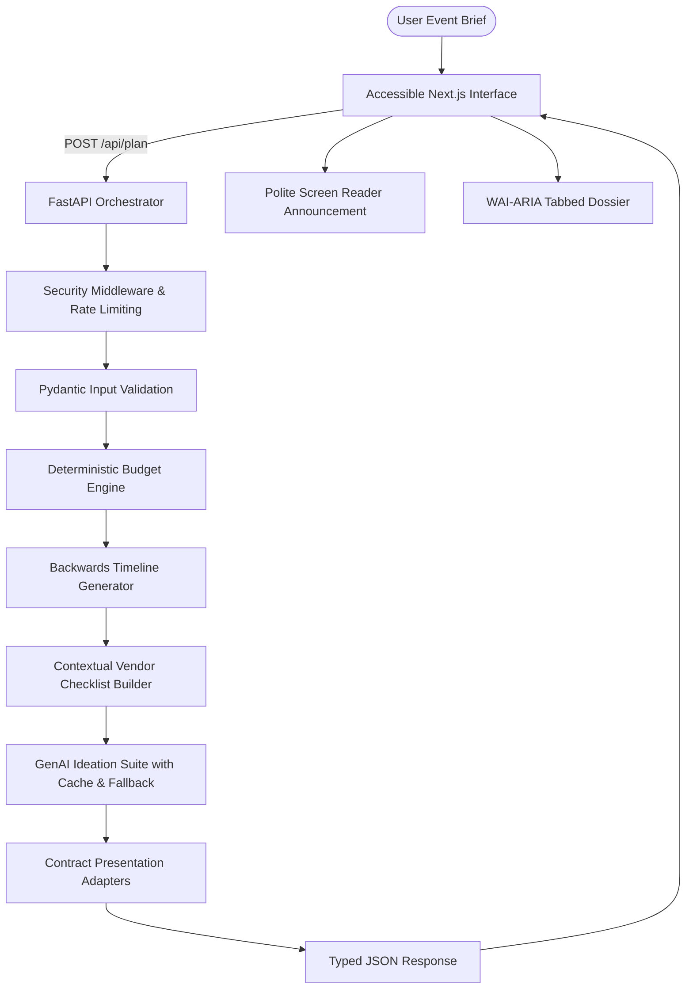

# Celebration & Event Studio

An accessible, context-aware event architecture assistant orchestrating deterministic financial allocations, backwards-planned milestone timelines, vendor due-diligence playbooks, and bespoke GenAI creative concepts for weddings, birthdays, and community gatherings.

**Live submission:** https://frontend-gamma-eight-yrqz4hhwj8.vercel.app

---

## 1. Chosen Vertical

**Celebration and Event Planning.** Specializing in weddings, milestone birthdays, and community gatherings, the studio provides structured, reliable event architecture for hosts, couples, and organizers managing real-world budgets, hard date deadlines, dietary protocols, and multi-vendor coordination.

---

## 2. Problem It Solves

Organizing large-scale celebrations is fraught with financial uncertainty, overlooked deadlines, and vendor friction. Most planning tools either rely entirely on manual spreadsheets or delegate critical arithmetic to generative AI models that hallucinate dates and budget numbers. Celebration & Event Studio solves this by combining mathematical determinism for finances and timelines with bounded, safe generative AI for creative ideation.

---

## 3. Features List

- **Deterministic Adaptive Budget Engine**: Calculates exact category allocations with 0-penny remainder guarantees, demographic adjustments, and weather contingency buffers.
- **Backwards-Planned Timeline Matrix**: Computes milestone tasks backwards from the event date, automatically engaging compressed scheduling modes for tight deadlines.
- **Context-Aware Vendor Due Diligence**: Generates tailored vendor checklists, booking deadlines, mandatory contract documents, and high-discretion interview questions.
- **Bespoke GenAI Ideation with Fallback**: Delivers themes, color palettes, menu concepts, and budget hacks using Google Gemini or OpenAI endpoints, transparently falling back to curated rule banks when offline.
- **"What-If" Dynamic Re-Planning Engine**: Allows interactive adjustments to budget, guest count, and date, producing live mathematical diffs and contextual advisor recommendations.
- **WAI-ARIA Accessible Interface**: Semantic HTML landmarks, WAI-ARIA tabs with arrow-key navigation, polite live region announcements, high-contrast focus rings, and reduced motion compliance.
- **Offline Client Deterministic Fallback**: The Next.js frontend contains a mirror of the deterministic calculation engine, ensuring full interactivity even during network interruptions.
- **Dossier Export & Persistence**: One-click print-to-PDF formatting, JSON dossier export, and task completion persistence in `localStorage`.

---

## 4. Approach and Logic

### Adaptive Budget Engine
- **Priorities Boost**: Users can select up to 3 focus priorities (e.g., Food, Decor, Music), boosting their baseline percentage allocation by +20% with proportional recalibration across remaining categories.
- **City Cost Tiering**: Metro locations automatically apply a +15% venue premium; small towns reduce venue overhead by -10%.
- **Dietary Surcharges**: Strict dietary requirements (Jain, Vegan, Halal, Gluten-Free) introduce dedicated kitchen and cookware isolation buffers (+8% catering adjustment).
- **Outdoor Weather Contingency**: Outdoor venues automatically mandate a 12% contingency allocation (compared to 8% standard) to protect against tenting, power, and weather contingencies.
- **Exact Remainder Rounding**: Currency rounding is reconciled so the sum of all categories plus contingency strictly equals 100.00% of the allocated budget.

### Backwards Timeline & Compression
- **Backwards Scheduling**: Tasks are scheduled backwards from the event date using industry-standard milestone intervals.
- **Lead Time Benchmark**: Weddings benchmark at 180 days, birthdays at 45 days, and community summits at 60 days.
- **Dynamic Compression**: When the planning horizon is shorter than benchmark, the engine activates "Compressed Schedule Mode", prioritizing high-urgency vendor deposits and immediate action items.

### Context-Aware Vendor Checklists
- Vendors are generated based on event type, demographic profile (e.g., dedicated children's entertainers for kids' birthdays), and venue setting (weatherproofing and sanitation vendors for outdoor community events).
- Low budget allocations trigger transparent vendor skip recommendations (e.g., recommending high-power speaker rentals instead of an expensive live band).

### GenAI Integration, Prompt Fencing & Safe Fallback
- Generative AI is strictly constrained to creative tasks (themes, decor suggestions, banquet menus, budget hacks).
- **Prompt Fencing**: Untrusted user inputs are isolated within `<UNTRUSTED_USER_PREFERENCES>` tags with strict instruction bounds.
- **Schema Validation**: LLM JSON output is strictly validated against Pydantic schemas. If output is invalid or the API key is missing, the system gracefully and transparently falls back to curated rules.

### Deterministic Money and Dates
- LLMs are never asked to perform arithmetic or calculate calendar offsets. All financial figures, due dates, and replanning deltas are computed using pure deterministic algorithms.

---

## 5. How the Solution Works



### Request Flow
1. **Intake**: User configures celebration archetype, guest count, budget, date, city tier, and preferences.
2. **Validation**: Pydantic validates input boundaries, rejects past dates, forbids extra fields, and sanitizes control characters.
3. **Execution**: The orchestrator computes budget allocations -> timeline tasks -> vendor checklists -> creative concepts.
4. **Presentation**: Response models adapt internal structures into the typed contract consumed by the UI.

---

## 6. Getting Started

### Prerequisites
- Python 3.11+
- Node.js 20+ and npm

### Local Installation & Run

1. **Clone Repository**:
   ```bash
   git clone https://github.com/rama76862-crypto/celebration-and-event-.git
   cd celebration-and-event-
   ```

2. **Backend Setup**:
   ```powershell
   python -m pip install -r requirements.txt
   Copy-Item .env.example .env
   python -m uvicorn app.main:app --host 127.0.0.1 --port 8000 --reload
   ```

3. **Frontend Setup (in a second terminal)**:
   ```powershell
   Set-Location frontend
   npm ci
   npm run dev
   ```
   Open `http://localhost:3000` in your browser.

---

## 7. Example Input & Sample Output

### Example Input (`POST /api/plan`)
```json
{
  "event_type": "birthday",
  "title": "Midnight Velvet Jubilee",
  "guest_count": 60,
  "total_budget": 300000.0,
  "currency": "INR",
  "event_date": "2026-12-15",
  "location": "Bengaluru",
  "city_tier": "metro",
  "preferences": {
    "theme": "Neon cyberpunk lounge",
    "dietary": ["vegetarian"],
    "indoor_outdoor": "indoor",
    "priorities": ["decor", "music"],
    "age_group": "adults",
    "notes": "Need LED walls and synthwave acoustics."
  }
}
```

### Sample Output (`200 OK`)
```json
{
  "budget": {
    "event_type": "birthday",
    "total_budget": 300000.0,
    "currency": "INR",
    "per_guest_cost": 5000.0,
    "categories": [
      {"name": "Venue & Atmosphere", "percentage": 28.0, "amount": 84000.0},
      {"name": "Food & Signature Cake", "percentage": 32.0, "amount": 96000.0},
      {"name": "Entertainment, DJ & Audio", "percentage": 22.0, "amount": 66000.0},
      {"name": "Thematic Decor & Photo-Ops", "percentage": 12.0, "amount": 36000.0},
      {"name": "Party Favors & Keepsakes", "percentage": 6.0, "amount": 18000.0}
    ],
    "total_allocated": 300000.0,
    "contingency_percentage": 8.0,
    "contingency_amount": 24000.0,
    "benchmark_warnings": []
  },
  "timeline": {
    "is_compressed": false,
    "days_remaining": 46,
    "all_tasks_sorted": [
      {"title": "Lock Venue Agreement", "due_date": "2026-11-05", "phase": "Now", "priority": "high"}
    ]
  },
  "vendors": {
    "recommended_vendors": [
      {"vendor_type": "DJ & Master of Ceremonies (MC)", "allocated_budget": 66000.0}
    ]
  },
  "ideas": {
    "source": "fallback",
    "theme_concepts": [
      {"name": "Cybernetic Velvet Lounge", "color_palette": ["#1e152a", "#a855f7", "#ec4899", "#f5df88"]}
    ]
  }
}
```

---

## 8. Accessibility Features (WCAG 2.1 AA Compliant)

- **Semantic Landmarks**: Explicit `<header>`, `<nav>`, `<main id="main-content">`, `<section>`, `<fieldset>`, `<legend>`, and `<footer>`.
- **WAI-ARIA Tabs Pattern**: Tab navigation bar featuring `role="tablist"`, `role="tab"`, `aria-selected`, `aria-controls`, `tabIndex`, and arrow-key navigation (Left, Right, Home, End).
- **Polite Live Announcements**: Dedicated `<div aria-live="polite" aria-atomic="true" className="sr-only">` announcing plan synthesis, tab changes, and re-planning status.
- **Form Association**: Explicit `<label htmlFor="...">` associated with every `<input id="...">`, `<select id="...">`, and `<textarea id="...">`.
- **Interactive Role Compliance**: Checkbox tasks implemented with `role="checkbox"`, `aria-checked`, and keyboard spacebar/enter activation; accordions use `aria-expanded` and `aria-controls`.
- **Focus Indicators**: High-contrast, visible `:focus-visible` ring across all interactive controls.
- **Skip-to-Content Link**: Accessible skip link allowing screen-reader and keyboard users to bypass navigation.
- **Reduced Motion Support**: Dedicated `@media (prefers-reduced-motion: reduce)` block disabling animations for users with vestibular motion sensitivity.
- **Touch Target Compliance**: Interactive buttons meet minimum 44x44px touch targets.

---

## 9. Security Measures Implemented

- **Defense-in-Depth Headers**: Emits `Strict-Transport-Security`, `Content-Security-Policy`, `X-Content-Type-Options: nosniff`, `X-Frame-Options: DENY`, `Referrer-Policy: strict-origin-when-cross-origin`, `Permissions-Policy`, `COOP: same-origin`, `CORP: cross-origin`, and `COEP: credentialless`.
- **Reverse-Proxy Rate Limiting**: Sliding window rate limiter enforcing 20 requests/minute per client, safely inspecting `X-Forwarded-For`.
- **Payload Size Guards**: Strict 100 KB payload size limit rejecting oversized requests with HTTP 413.
- **Sanitized Delimited Prompt Defense**: User text is bounded within delimiter tags; system prompt instructs LLM to treat inputs strictly as untrusted data.
- **Zero Committed Secrets**: `.env` is strictly git-ignored; error handlers mask raw stack traces to prevent credential reflection.

---

## 10. Automated Testing & Verification

### Run Test Suite
```powershell
# Run backend tests with coverage report
python -m pytest --cov=app --cov-report=term-missing

# Run code style and linter checks
python -m ruff check app tests

# Run frontend tests
Set-Location frontend
npm test

# Run frontend lint and build
npm run lint
npm run build
```

### Coverage Summary
- **Backend Test Suite**: 86 automated tests across unit, integration, boundary, and security test files.
- **Backend Statement Coverage**: **100% coverage** across all modules (`app.main`, `app.ai.client`, `app.models`, `app.config`, `app.planner.*`, `app.presentation`).
- **Frontend Test Suite**: Zero-dependency automated test runner verifying currency formatting, contingency rules, and replan math.

---

## 11. Assumptions Made

- **Planning Guidance**: Cost benchmarks and vendor allocations are heuristic planning guidelines, not guaranteed contractual quotes.
- **Industry Lead Times**: Recommended lead times (180 days for weddings, 45 for birthdays, 60 for community events) reflect typical vendor availability horizons.
- **Stateless Persistence**: The application intentionally does not require user accounts or persistent remote databases, preserving user privacy. Local state (task checklists) is held in client `localStorage`.

---

## 12. Limitations & Future Improvements

- **Vendor Marketplace Connectivity**: Real-time RFPs and live vendor booking APIs could be integrated with verified local vendor directories.
- **Multi-Day Itinerary Support**: Expanding the single-day timeline engine to multi-day destination weddings or multi-stage weekend community festivals.
- **Guest RSVP Portal**: Introducing SMS/WhatsApp RSVP tracking with live seat-count recalibration.

---

## 13. Project Structure

```text
celebration-and-event/
├── .github/
│   └── workflows/
│       └── ci.yml               # GitHub Actions CI gate (Python + Node.js)
├── app/
│   ├── ai/
│   │   ├── __init__.py
│   │   └── client.py            # Provider-agnostic LLM client with cache & retry
│   ├── planner/
│   │   ├── __init__.py
│   │   ├── advisor.py           # Re-planning diff engine & financial advisor
│   │   ├── budget.py            # Deterministic budget engine (0-penny remainder)
│   │   ├── ideas.py             # GenAI creative moodboard with rules fallback
│   │   ├── prompt_templates.py  # Fenced system & user prompt templates
│   │   ├── rules.py             # Baseline allocations, lead times & curated bank
│   │   ├── timeline.py          # Backwards milestone timeline & run-of-show
│   │   └── vendors.py           # Contextual vendor checklist & interview playbook
│   ├── config.py                # Environment configuration settings
│   ├── main.py                  # FastAPI app, security middleware & endpoints
│   ├── models.py                # Pydantic schemas, enums, & field sanitizers
│   └── presentation.py          # UI contract presentation adapters
├── frontend/
│   ├── src/
│   │   ├── app/
│   │   │   ├── birthday/page.tsx
│   │   │   ├── community/page.tsx
│   │   │   ├── planner/page.tsx # Interactive WAI-ARIA tabbed studio experience
│   │   │   ├── wedding/page.tsx
│   │   │   ├── globals.css      # Design tokens, focus styles & reduced motion
│   │   │   ├── layout.tsx       # Root layout with skip-to-content landmark
│   │   │   └── page.tsx         # Hero landing experience
│   │   ├── components/          # Navigation, audio haptics & 3D canvas
│   │   └── lib/                 # Client deterministic engine, types & API client
│   ├── tests/
│   │   └── client_engine.test.mjs # Frontend automated tests
│   └── package.json
├── tests/
│   ├── test_advisor.py          # Replan diff & financial advisor tests
│   ├── test_ai_client.py        # Gemini/OpenAI format, cache, retry & timeout tests
│   ├── test_api.py              # API contract, headers, rate limit & security tests
│   ├── test_api_endpoints.py    # Standalone endpoints, proxy & error handler tests
│   ├── test_budget.py           # Exact remainder, priorities & contingency tests
│   ├── test_edge_cases.py       # Boundary guest counts, dates & unicode tests
│   ├── test_edge_cases_extended.py # Branch coverage & demographic edge tests
│   ├── test_health.py           # Health probe tests
│   ├── test_ideas.py            # AI parsing, prompt injection & fallback tests
│   ├── test_models.py           # Pydantic validation & sanitization tests
│   ├── test_timeline.py         # Compressed scheduling & run-of-show tests
│   └── test_vendors.py          # Vendor due diligence & skip logic tests
├── .env.example
├── .gitignore
├── pytest.ini
├── render.yaml
├── requirements.txt
├── ruff.toml
├── SECURITY.md                  # Comprehensive security policy & threat model
└── README.md
```
